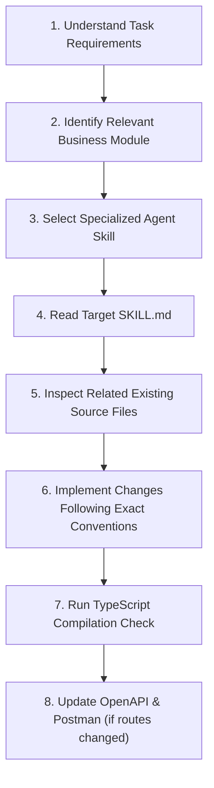

# Scan & Dine — AI Agent Engineering Guide (`AGENTS.md`)

> **Canonical System Instructions for Antigravity AI Agents**  
> **Workspace**: `scan-and-dine-monorepo`  
> **Target Framework**: Express 4.x + TypeScript + Mongoose (Modular Architecture / Microservices-Ready)

---

## 1. Technology Stack & Runtime Environment

- **Runtime**: Node.js (`>=20.0.0`, ESM `"type": "module"`)
- **Language**: TypeScript (`v5.6.3`, target `ES2022`, module resolution `NodeNext`)
- **HTTP Engine**: Express.js (`v4.21.1`) with modular routers
- **Database & ODM**: MongoDB (`v8.8.0`) with Mongoose
- **Real-Time Communication**: Socket.io (`v4.8.1`) with `@socket.io/redis-adapter` and `ioredis` (`v5.4.1`)
- **Schema Validation**: Zod (`v3.23.8`)
- **Payments**: Stripe (`v17.3.1`)
- **Logging**: Pino (`v9.5.0`) structured JSON logger
- **API Documentation**: OpenAPI 3.0 / Swagger UI (`swagger-ui-express`) with automated Postman collection generator

*Note: While some high-level user specifications refer to NestJS, this codebase is strictly implemented as a clean, modular Express + TypeScript + Mongoose application. All agents must adapt to this real architecture and never attempt to convert it to standard NestJS decorators.*

---

## 2. High-Level Architecture Rules

1. **Modular Architecture (Microservices-Ready)**:
   - All business logic lives in self-contained feature folders under `src/modules/<domain>/<feature>/`.
   - Shared platform code lives in `src/shared/` (`middlewares/`, `constants/`, `event-bus/`, `logger/`, `types/`, `utils/`).
2. **Dual Execution Modes**:
   - `SERVICE_NAME=ALL` (default: `npm run dev`) boots all modules and WebSockets together on port `3000`.
   - `SERVICE_NAME=AUTH|MENU|ORDERS|WS` boots individual microservices on isolated ports (`3001`, `3002`, `3003`, `3005`).
3. **Master Route Aggregation Standard**:
   - Sub-route files define relative paths (e.g. `router.get("/floor-map", ...)`).
   - Domain routers aggregate sub-routes (e.g. `router.use("/waiter", waiterRouter)`).
   - `server.ts` mounts domain routers under `/api/v1` (e.g. `app.use("/api/v1", orderRoutes)`).
   - **Rule**: Never repeat `/api/v1/` inside sub-route files.
4. **Self-Contained Feature Folders (No Barrel File Anti-Patterns)**:
   - Each feature directory holds its own `*.enum.ts`, `*.interface.ts`, `*.model.ts`, `*.validation.ts`, `*.service.ts`, `*.controller.ts`, and `*.route.ts`.
   - Never create `index.ts` files inside feature subfolders.

---

## 3. Mandatory Coding Conventions

1. **Double Quotes (`"`) Mandatory**:
   - Every string literal across the entire codebase (imports, route paths, logs, return messages, object keys, enums) must be written inside double quotes (`"`). Single quotes (`'`) are prohibited.
2. **Controller Safety Wrapper (`errorWrapper` / `asyncHandler`)**:
   - Every controller method must be wrapped in `errorWrapper`.
   - Controllers never perform database queries directly.
3. **Standardized Response Envelope (`responseUtils`)**:
   - Always return responses via `responseUtils.success(res, { data, message, status, meta })`.
4. **Zero Hardcoded Messages Rule (`messages.constant.ts`)**:
   - Always call reusable message builders passing the field/entity name first:
     - `errorMessage.notFound("Order")` ➔ `"Order not found"`
     - `errorMessage.alreadyExists("Table")` ➔ `"Table already exists"`
     - `errorMessage.isRequired("Venue ID")` ➔ `"Venue ID is required"`
     - `successMessage.created("Order")` ➔ `"Order created successfully"`
     - `successMessage.fetched("Floor map")` ➔ `"Floor map fetched successfully"`
5. **No Restaurant Slang**:
   - Never use the slang `"86"`. Always use clean terms like `item-availability`, `toggleItemAvailability`, `ITEM_OUT_OF_STOCK`.
6. **Error Generation Standard (`generateAPIError` & `APIError`)**:
   - Always trigger operational API errors using:
     `return await generateAPIError(errorMessage.<key>, statusCode, errorCode?, data?);`
   - Logs diagnostics via `console.log(msg, statusCode, "error")` and throws structured `APIError`.
   - Never throw raw untyped JavaScript `Error` objects.
7. **Strict TypeScript Typing (Zero `any` Standard)**:
   - Never use `as any` or raw untyped `any` when strong typing or existing interfaces can be applied.
   - Always reuse existing interfaces/types (e.g. `JwtAuthPayload`, `AuthenticatedUser`, `SignOptions`, domain DTOs) from `src/shared/types` or domain `*.interface.ts`.
   - When signing JWTs, type options with `SignOptions` and cast `expiresIn` to `SignOptions["expiresIn"]`. When verifying JWTs, cast decoded tokens to their typed payload interface (`JwtAuthPayload` or `AuthenticatedUser`).
   - Only fall back to `unknown` or `any` if a third-party library genuinely lacks types, and document the reason.

---

## 4. Multi-Tenancy & Database Safety

1. **Tenant Isolation**: Every database query in services must include `{ venueId }` and `{ deletedAt: null }`.
2. **Soft Deletions**: Never execute `.deleteOne()` on core business models (Orders, MenuItems, Venues, Users). Use soft-delete `deletedAt: new Date()`.
3. **Financial Immutability**: Order totals and payment transactions must never be mutated after settlement. All adjustments require a new `Transaction` ledger entry.
4. **Secrets Protection**: `passwordHash` and `pinCodeHash` must never be selected or returned in API responses.

---

## 5. Automatic Skill Discovery & Selection Workflow

Before executing any coding task, agents must execute this mandatory 8-step workflow:

### Specialized Project Skills Matrix

| Task Area | Specialized Skill Path | Purpose |
| :--- | :--- | :--- |
| **System Overview & Monorepo Rules** | `.agents/skills/scandine-monorepo-standards/SKILL.md` | Single-port dev runner, SOLID principles, master prefixes |
| **New Features & Domain Folders** | `.agents/skills/scandine-module-development/SKILL.md` | Self-contained feature folder topology, service decoupling |
| **REST APIs, Zod & Controllers** | `.agents/skills/scandine-api-standards/SKILL.md` | `errorWrapper`, `responseUtils`, Zod validation, OpenAPI docs |
| **MongoDB & Mongoose Schemas** | `.agents/skills/scandine-database-mongoose/SKILL.md` | Document typing, compound indexing, tenant isolation |
| **Auth, Roles, PINs & Geofencing** | `.agents/skills/scandine-auth-security/SKILL.md` | JWT auth, RBAC roles, staff PIN login, GPS geofence |
| **WebSockets & Pub/Sub Events** | `.agents/skills/scandine-realtime-event-bus/SKILL.md` | Redis pub/sub, `EventChannels`, Socket.io room routing |

---

## 6. Verification & Quality Gates

Before concluding any turn:
1. **TypeScript Build Verification**: Run `npm run build` or `npx tsc --noEmit` to confirm zero compiler errors.
2. **API Spec Sync**: When adding or updating endpoints, update `src/docs/openapi.json` and run `npm run postman:gen`.
3. **No Unintended Changes**: Do not touch unrequested files, schemas, or dependencies.
