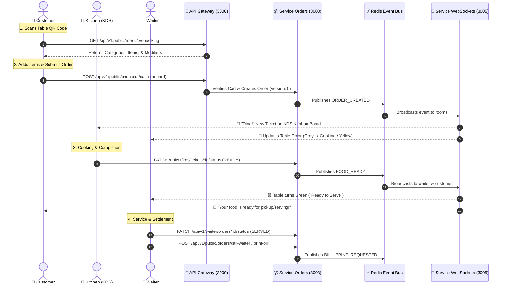

# 🍽️ Scan & Dine — Omnichannel Restaurant SaaS Monorepo

> **Scan & Dine** is an enterprise-grade, multi-tenant SaaS platform modernizing restaurant, cafe, and food court operations with QR-based digital ordering, real-time kitchen display systems (KDS), floor staff cart mirroring, and automated billing.

---

## 📑 Table of Contents
1. [Architecture Overview](#-architecture-overview)
2. [End-to-End System Flow (How It Works)](#-end-to-end-system-flow-how-it-works)
3. [Port & Service Mapping](#-port--service-mapping)
4. [Prerequisites & Package Installation](#-prerequisites--package-installation)
5. [How to Install New Packages (The Monorepo Flow)](#-how-to-install-new-packages-the-monorepo-flow)
6. [Building the Applications (Build Flow)](#-building-the-applications-build-flow)
7. [Running in Development (Run Flow)](#-running-in-development-run-flow)
8. [How the Code Works (Architecture Deep-Dive)](#-how-the-code-works-architecture-deep-dive)
9. [Running in Production (Hostinger VPS / PM2 / Nginx)](#-running-in-production-hostinger-vps--pm2--nginx)
10. [Troubleshooting & FAQ](#-troubleshooting--faq)

---

## 🏛️ Architecture Overview

The repository is organized as a **Turborepo TypeScript Monorepo** separating backend microservices, frontend applications, and shared libraries:

```
scan-and-dine-monorepo/
│
├── apps/
│   ├── server/                          # ── BACKEND MICROSERVICES ──
│   │   ├── api-gateway/ (Port 3000)      # Public reverse proxy, rate limiting, CORS
│   │   ├── service-auth/ (Port 3001)     # Users, RBAC, 4-digit PIN login, HR shifts, device UUID
│   │   ├── service-menu/ (Port 3002)     # Menu CMS, categories, 86-ing stock toggles, inventory, promos
│   │   ├── service-orders/ (Port 3003)   # Cart, checkout, Stripe payment intents, KDS SLA timers, ledger
│   │   └── service-websockets/ (Port 3005) # Socket.io + Redis adapter, rooms for venue, KDS, & tables
│   │
│   ├── web/ (Port 4000)                  # ── CUSTOMER NEXT.JS PWA (Scan to Order) ──
│   ├── waiter/ (Port 4001)               # ── WAITER NEXT.JS APP (Live Floor Map & Cart Mirror) ──
│   └── admin/ (Port 4002)                # ── VENUE ADMIN NEXT.JS APP (CMS, Analytics, QR Gen) ──
│
├── packages/                             # ── SHARED WORKSPACES ──
│   ├── shared-types/                     # TypeScript interfaces, enums, & DTOs
│   ├── shared-middlewares/               # JWT, RBAC, Tenancy, Feature Flags, Zod validator
│   ├── event-bus/                        # Redis Pub/Sub wrapper with graceful offline fallback
│   ├── logger/                           # Pino JSON structured logging & HTTP tracing
│   └── ui-components/                    # Shared Tailwind components (Button, Input, Modal, Badges)
│
├── turbo.json                            # Turborepo task pipeline
├── package.json                          # Monorepo workspaces definition
└── tsconfig.base.json                    # Shared TypeScript base configuration
```

---

## 🔄 End-to-End System Flow (How It Works)



---

## 🔌 Port & Service Mapping

| App / Service | Default Port | Internal Role | Accessible By |
| :--- | :---: | :--- | :--- |
| **`api-gateway`** | `3000` | Reverse Proxy, Rate Limiter, Swagger Docs (`/api/docs`) | **Public / Frontends** |
| **`service-auth`** | `3001` | Authentication, RBAC, PINs, Shifts | Gateway Only |
| **`service-menu`** | `3002` | Catalog, 86-ing, Inventory, Promos | Gateway Only |
| **`service-orders`** | `3003` | Carts, Checkout, KDS, Ledger | Gateway Only |
| **`service-websockets`** | `3005` | Socket.io Real-Time Engine | **Direct Socket Connections** |
| **`apps/web`** | `4000` | Customer Scan-to-Order PWA | End Customers |
| **`apps/waiter`** | `4001` | Floor Staff Tablet/Mobile App | Waiters / Managers |
| **`apps/admin`** | `4002` | Restaurant Management Portal | Venue Admins |

---

## 📦 Prerequisites & Package Installation

### 1. Prerequisites
* **Node.js**: `v20.0.0` or higher (`node -v`)
* **NPM**: `v10.0.0` or higher (`npm -v`)
* **MongoDB**: A free cloud instance on [MongoDB Atlas](https://www.mongodb.com/cloud/atlas) (or local MongoDB on `mongodb://localhost:27017`)
* **Redis** *(Optional for local dev)*: Local Redis or cloud Redis (Upstash/Aiven). *Note: The system contains built-in graceful offline fallbacks if Redis is not installed locally.*

### 2. Initial Setup (Clone & Install)
Run from the root directory:
```bash
npm install
```
This automatically links all internal packages (`@scan-and-dine/shared-types`, `@scan-and-dine/shared-middlewares`, etc.) across workspaces without needing to publish to NPM.

### 3. Configure Environment Variables
Copy `.env.example` to `.env`:
```bash
cp .env.example .env
```
Fill in your `MONGO_URI`, `JWT_SECRET`, and optional `STRIPE_SECRET_KEY`.

---

## 📥 How to Install New Packages (The Monorepo Flow)

In an **NPM Workspaces / Turborepo** monorepo, **never** run a plain `npm install <pkg>` in the root directory without specifying where it belongs. 

Always stay in the **root folder** and use the **`-w` (workspace)** flag to target the specific service or app.

```bash
npm install <package-name> -w <workspace-name>
```

### A. Installing in a Backend Microservice
Workspace names match the `name` field in each service's `package.json`:
* `service-orders` ➔ `@scan-and-dine/service-orders`
* `service-auth` ➔ `@scan-and-dine/service-auth`
* `service-menu` ➔ `@scan-and-dine/service-menu`
* `service-websockets` ➔ `@scan-and-dine/service-websockets`
* `api-gateway` ➔ `@scan-and-dine/api-gateway`

```bash
# Example 1: Add Stripe to service-orders
npm install stripe -w @scan-and-dine/service-orders

# Example 2: Add bcrypt to service-auth
npm install bcryptjs -w @scan-and-dine/service-auth

# Example 3: Add Axios to service-menu
npm install axios -w @scan-and-dine/service-menu
```

### B. Installing in a Frontend Web App
* Customer Web App ➔ `@scan-and-dine/web`
* Waiter App ➔ `@scan-and-dine/waiter`
* Admin Dashboard ➔ `@scan-and-dine/admin`

```bash
# Example 1: Add chart library (recharts) to Admin Dashboard
npm install recharts -w @scan-and-dine/admin

# Example 2: Add icons (lucide-react) to Customer Web App
npm install lucide-react -w @scan-and-dine/web

# Example 3: Add sound alert library (howler) to Waiter App
npm install howler -w @scan-and-dine/waiter
```

### C. Installing Dev Dependencies & Types (`-D`)
Append `-D` or `--save-dev`:
```bash
# Add TypeScript types to service-orders
npm install -D @types/stripe -w @scan-and-dine/service-orders

# Add Tailwind plugin to Admin Dashboard
npm install -D @tailwindcss/typography -w @scan-and-dine/admin
```

### D. Connecting Internal Workspace Packages
To use internal packages like `@scan-and-dine/ui-components` or `@scan-and-dine/shared-types` inside an app:
```bash
npm install @scan-and-dine/ui-components@* -w @scan-and-dine/web
```
*(Or add `"@scan-and-dine/ui-components": "*"` in that app's `package.json` dependencies and run `npm install`).*

### 📋 Package Installation Cheat Sheet

| Goal | Command (from Monorepo Root) |
| :--- | :--- |
| Add package to **Orders Service** | `npm install <pkg> -w @scan-and-dine/service-orders` |
| Add package to **Auth Service** | `npm install <pkg> -w @scan-and-dine/service-auth` |
| Add package to **Menu Service** | `npm install <pkg> -w @scan-and-dine/service-menu` |
| Add package to **Customer Web** | `npm install <pkg> -w @scan-and-dine/web` |
| Add package to **Waiter App** | `npm install <pkg> -w @scan-and-dine/waiter` |
| Add package to **Admin Dashboard** | `npm install <pkg> -w @scan-and-dine/admin` |
| Add package to **Shared Types** | `npm install <pkg> -w @scan-and-dine/shared-types` |
| Add dev tool for **Entire Monorepo** | `npm install -D <pkg>` *(no `-w`)* |

---

## 🔨 Building the Applications (Build Flow)

The monorepo uses **Turborepo** to build both backend TypeScript microservices and Next.js frontend applications in the correct dependency order.

### How the Build Pipeline Works
In `turbo.json`, the build task defines `"dependsOn": ["^build"]`. This guarantees that shared dependencies (like `@scan-and-dine/shared-types` and `@scan-and-dine/ui-components`) compile **first** before the apps consuming them start compiling.

### Flow 1: Build the Entire Monorepo (All Services & Frontends)
From the monorepo root:
```bash
npm run build
```
*(Or with Turborepo directly: `npx turbo run build`)*

**What happens:**
1. Turborepo analyzes the dependency graph across all 13 packages.
2. Compiles `@scan-and-dine/shared-types`, `@scan-and-dine/shared-middlewares`, `@scan-and-dine/ui-components`, `@scan-and-dine/logger`, `@scan-and-dine/event-bus`.
3. Compiles all 5 Express backend microservices via `tsc` into their respective `dist/` folders.
4. Builds all 3 Next.js applications (`apps/web`, `apps/waiter`, `apps/admin`) via `next build` into `.next/`.
5. Caches successful builds. Future builds complete in milliseconds if files have not changed.

---

### Flow 2: Build a Single Service or Application (Targeted Build)

You have three flexible methods to build an individual service or app:

#### Method A: Using Turborepo Filter from Root (Recommended)
Turborepo's `--filter` automatically resolves and builds prerequisite internal packages first:
```bash
# Build only the Waiter Next.js App:
npx turbo run build --filter=@scan-and-dine/waiter

# Build only the Customer Web App:
npx turbo run build --filter=@scan-and-dine/web

# Build only the Admin Dashboard:
npx turbo run build --filter=@scan-and-dine/admin

# Build only the API Gateway:
npx turbo run build --filter=@scan-and-dine/api-gateway

# Build only the Orders Microservice:
npx turbo run build --filter=@scan-and-dine/service-orders
```

#### Method B: Using NPM Workspace Flag `-w` from Root
```bash
# Build waiter app
npm run build -w @scan-and-dine/waiter

# Build API gateway
npm run build -w @scan-and-dine/api-gateway
```

#### Method C: Build Directly Inside the App's Directory
Navigate directly into the target app's directory:
```bash
# Build Waiter app directly:
cd apps/waiter
npm run build

# Build Orders service directly:
cd apps/server/service-orders
npm run build
```

---

### Build Artifact Locations
| Workspace | Build Tool | Output Directory |
| :--- | :---: | :--- |
| **`apps/server/*`** (Microservices) | TypeScript (`tsc`) | `apps/server/<service>/dist/` |
| **`apps/web`** (Customer PWA) | Next.js (`next build`) | `apps/web/.next/` |
| **`apps/waiter`** (Waiter App) | Next.js (`next build`) | `apps/waiter/.next/` |
| **`apps/admin`** (Admin CMS) | Next.js (`next build`) | `apps/admin/.next/` |

---

## 🚀 Running in Development (Run Flow)

### Step-by-Step: From Zero to Running

#### Step 1: Install Dependencies
Run once from the root directory:
```bash
npm install --legacy-peer-deps
```

#### Step 2: Configure Environment Variables
Copy `.env.example` to `.env` and verify your MongoDB connection string and ports:
```bash
cp .env.example .env
```

---

### Run Mode 1: Run Everything Concurrently (Recommended)
To boot all 5 backend microservices and all 3 Next.js frontend applications simultaneously in a single terminal:
```bash
npm run dev
```
*Turborepo will start all 8 processes in parallel with color-coded prefix tags in your console.*

**Once running, open your browser:**
* 📱 **Customer Web App**: [http://localhost:4000](http://localhost:4000)
* 🤵 **Waiter Floor Map & Staff App**: [http://localhost:4001](http://localhost:4001)
* 📊 **Admin Dashboard & CMS**: [http://localhost:4002](http://localhost:4002)
* 🚪 **API Gateway & Swagger Docs**: [http://localhost:3000/api/docs](http://localhost:3000/api/docs)

---

### Run Mode 2: Run Targeted Functional Stacks (Save Memory & RAM)
If running on a laptop or machine with limited RAM, start only the specific functional stack you need:

```bash
# 1. Customer Ordering Stack (Customer App + API Gateway + Menu Service):
npx turbo run dev --filter=@scan-and-dine/web --filter=@scan-and-dine/api-gateway --filter=@scan-and-dine/service-menu

# 2. Kitchen & Waiter Stack (Waiter App + Gateway + Orders Service + WebSockets):
npx turbo run dev --filter=@scan-and-dine/waiter --filter=@scan-and-dine/api-gateway --filter=@scan-and-dine/service-orders --filter=@scan-and-dine/service-websockets

# 3. Admin & CMS Stack (Admin Dashboard + Gateway + Menu + Orders):
npx turbo run dev --filter=@scan-and-dine/admin --filter=@scan-and-dine/api-gateway --filter=@scan-and-dine/service-menu --filter=@scan-and-dine/service-orders
```

---

### Run Mode 3: Run a Single Application Individually

#### Method A: From Root Using NPM Workspace Flag
```bash
# Run only Waiter App (Port 4001):
npm run dev -w @scan-and-dine/waiter

# Run only API Gateway (Port 3000):
npm run dev -w @scan-and-dine/api-gateway

# Run only Orders Microservice (Port 3003):
npm run dev -w @scan-and-dine/service-orders
```

#### Method B: Direct Folder Navigation
```bash
cd apps/waiter
npm run dev
```

---

## 🧠 How the Code Works (Architecture Deep-Dive)

### 1. The "Feature-Module" Backend Pattern
Every microservice under `apps/server/` is organized strictly by business domain (e.g. `modules/orders`, `modules/kds`, `modules/menu-items`):
* **`*.route.ts`**: Defines HTTP routes and attaches authorization guards (`authenticateJwt`, `requireRole`, `requireVenueId`).
* **`*.controller.ts`**: Unpacks `req.body` / `req.params`, delegates work to the service, and returns clean JSON responses.
* **`*.service.ts`**: Contains all database queries, business rules, calculations, and event dispatching.
* **`*.model.ts`**: Mongoose document schemas with compound multi-tenant indexes.
* **`*.validation.ts`**: Zod schemas validating request payloads before any code runs.

### 2. Multi-Tenancy & The "Invisible Wall"
All tenants share the database, but data is logically isolated:
* When staff or admins log in, their token embeds `venueId`.
* `tenancy.middleware.ts` extracts and attaches `req.venueId`.
* Database queries strictly filter by `venueId: req.venueId`.
* Compound indexes like `{ venueId: 1, status: 1 }` ensure ultra-fast query execution.

### 3. Concurrency Protection (The Friday Night Spike)
When multiple waiters or customers interact with the same table order:
* The order document contains a `version: Number` field.
* Updates use **Optimistic Locking**:
  ```typescript
  OrderModel.findOneAndUpdate(
    { _id: orderId, venueId, version: currentVersion },
    { $set: updates, $inc: { version: 1 } },
    { new: true }
  );
  ```
  If another staff member updated the order first, the update fails cleanly with a `409 Conflict` instead of corrupting data or double-charging.

### 4. Instant 86-ing (Out-of-Stock Engine)
1. Kitchen chef taps "86 Item" on a sold-out dish.
2. `service-menu` updates `isAvailable: false`.
3. `service-menu` calls `publishEvent(EventChannels.ITEM_86ED, ...)`.
4. `service-websockets` receives the Redis event and emits `item_stock_updated` to the room `venue:{venueId}`.
5. All active customer phones immediately gray out the item in real time without refreshing the browser.

---

## 🌐 Running in Production (Hostinger VPS / PM2 / Nginx)

### Step 1: Build the Entire Monorepo
Compile TypeScript across all packages and microservices:
```bash
npm run build
```

### Step 2: PM2 Process Management
Create an `ecosystem.config.cjs` in the root:
```javascript
module.exports = {
  apps: [
    {
      name: 'scandine-gateway',
      script: './apps/server/api-gateway/dist/server.js',
      instances: 1,
      env: { NODE_ENV: 'production', PORT_GATEWAY: 3000 },
    },
    {
      name: 'scandine-auth',
      script: './apps/server/service-auth/dist/server.js',
      instances: 2,
      exec_mode: 'cluster',
      env: { NODE_ENV: 'production', PORT_AUTH: 3001 },
    },
    {
      name: 'scandine-menu',
      script: './apps/server/service-menu/dist/server.js',
      instances: 2,
      exec_mode: 'cluster',
      env: { NODE_ENV: 'production', PORT_MENU: 3002 },
    },
    {
      name: 'scandine-orders',
      script: './apps/server/service-orders/dist/server.js',
      instances: 'max', // Scale across all available CPU cores for rush hours
      exec_mode: 'cluster',
      env: { NODE_ENV: 'production', PORT_ORDERS: 3003 },
    },
    {
      name: 'scandine-ws',
      script: './apps/server/service-websockets/dist/server.js',
      instances: 2,
      exec_mode: 'cluster',
      env: { NODE_ENV: 'production', PORT_WEBSOCKETS: 3005 },
    },
  ],
};
```

Launch all services:
```bash
pm2 start ecosystem.config.cjs
pm2 save
pm2 startup
```

### Step 3: Nginx Reverse Proxy Setup
Add this Nginx configuration to route public domain requests to your internal ports:

```nginx
# Public REST API (Gateway on Port 3000)
server {
    listen 80;
    server_name api.yourdomain.com;

    location / {
        proxy_pass http://127.0.0.1:3000;
        proxy_http_version 1.1;
        proxy_set_header Host $host;
        proxy_set_header X-Real-IP $remote_addr;
        proxy_set_header X-Forwarded-For $proxy_add_x_forwarded_for;
        proxy_set_header X-Forwarded-Proto $scheme;
    }
}

# Real-Time WebSocket Server (WebSockets on Port 3005)
server {
    listen 80;
    server_name socket.yourdomain.com;

    location / {
        proxy_pass http://127.0.0.1:3005;
        proxy_http_version 1.1;
        proxy_set_header Upgrade $http_upgrade;
        proxy_set_header Connection "upgrade";
        proxy_set_header Host $host;
        proxy_set_header X-Real-IP $remote_addr;
        proxy_set_header X-Forwarded-For $proxy_add_x_forwarded_for;
    }
}
```

---

## ❓ Troubleshooting & FAQ

### Q: What if I get `'turbo' is not recognized as an internal or external command`?
**A:** This occurs if `npm install` hasn't been executed at the root of the monorepo yet. Running:
```bash
npm install --legacy-peer-deps
```
from `d:\nexcrow\scan-and-dine-monorepo` will install Turborepo and TypeScript into `node_modules/.bin` and make `turbo` / `tsc` commands available across your workspace.

### Q: What if Turborepo says `Missing devEngines.packageManager or legacy packageManager field in package.json`?
**A:** Turborepo 2.x requires the package manager to be declared in the root `package.json`. Ensure this line exists in your root `package.json`:
```json
"packageManager": "npm@10.9.8"
```
*(This is already pre-configured in this repository).*

### Q: What if Redis is not running on my local machine?
**A:** We added an offline fallback into `@scan-and-dine/event-bus`. If Redis is not detected locally, the services log a warning and continue running in dev mode without crashing. When you are ready for cross-process sync, simply start `redis-server`.

### Q: Why do the frontends only talk to Port 3000?
**A:** `api-gateway` (Port 3000) acts as the unified reverse proxy. It inspects URL prefixes (`/api/v1/auth`, `/api/v1/public/menu`, `/api/v1/public/cart`) and transparently routes them to the correct internal microservices. Frontends only need one `NEXT_PUBLIC_API_URL=http://localhost:3000`.

### Q: How do I avoid MongoDB connection limits on free tiers?
**A:** In [`database.ts`](file:///d:/nexcrow/scan-and-dine-monorepo/apps/server/service-orders/src/config/database.ts), we set `MONGO_MAX_POOL_SIZE` configurable via environment variables with a safe default of `20`. For starter MongoDB Atlas clusters, 20 pooled connections per service ensures you never exceed your tier cap.

---

## 📜 License
Private & Proprietary — Scan & Dine SaaS Platform.
