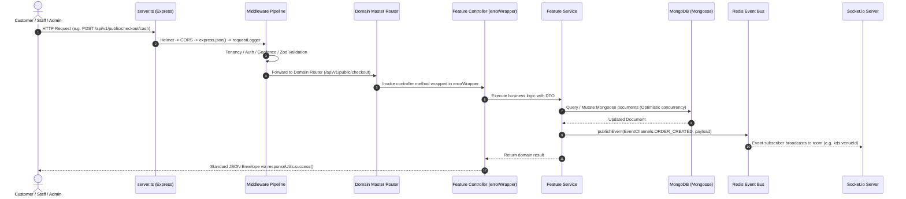
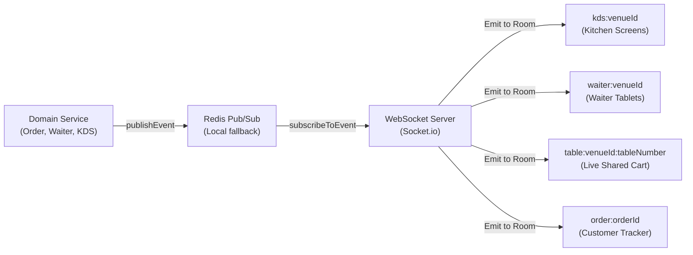

# Scan & Dine — Comprehensive Project Architecture Manual

> **Canonical System Documentation**  
> **Workspace**: `scan-and-dine-monorepo`  
> **Version**: 1.0.0  
> **Target Framework**: Express 4.x + TypeScript + Mongoose (Modular Architecture / Microservices-Ready)

---

## 1. Actual Project Architecture

Scan & Dine is architected as a **Clean Modular Monolith (Microservices-Ready)**. While the prompt referenced NestJS as a technology detail, deep analysis of `package.json`, `tsconfig.json`, and the source code reveals that this project is implemented using **Express.js (v4.21.1)**, **TypeScript (v5.6.3)**, **Mongoose (v8.8.0)**, **Zod (v3.23.8)**, **Socket.io (v4.8.1)**, and **Redis (ioredis v5.4.1)**.

### Architecture Highlights
- **Consolidated Modular Root**: Single consolidated `package.json` and unified `tsconfig.json` avoiding fragile npm/yarn/pnpm workspace symlink overhead.
- **Dual Execution Modes**:
  1. **Unified Dev Mode (`SERVICE_NAME=ALL`)**: Boots all modules (Auth, Menu, Orders), WebSockets, and Swagger UI together on port `3000`.
  2. **Microservice Runner Mode (`SERVICE_NAME=AUTH|MENU|ORDERS|WS`)**: Boots any domain independently on its dedicated port (`3001`, `3002`, `3003`, `3005`).
- **Feature Folders (SRP)**: Each business capability lives in its own self-contained folder under `src/modules/<domain>/<feature>/`. Redundant module-level barrel files are strictly prohibited.
- **Event-Driven Pub/Sub**: Real-time cross-module communication is decoupled through Redis Pub/Sub (`src/shared/event-bus/`) with an automatic, silent in-memory Node.js `EventEmitter` fallback for offline local development.

---

## 2. Directory Structure and Responsibilities

```text
scan-and-dine-monorepo/
├── src/
│   ├── modules/                                  # ── BUSINESS DOMAIN FEATURE MODULES ──
│   │   ├── auth/                                 # Authentication, Staff, Customers & Shift Management
│   │   │   ├── auth/                             # Admin Login, Staff PIN Login, Customer silent session
│   │   │   ├── users/                            # Staff & Manager user CRUD, RBAC roles, pinCodeHash
│   │   │   ├── customers/                        # Device UUID tracking, loyalty points, customer metrics
│   │   │   ├── shifts/                           # Timeclock, breaks, wage calculations, manager approvals
│   │   │   └── routes.ts                         # Auth master router (exports authRoutes)
│   │   │
│   │   ├── menu/                                 # Restaurant Catalog & Physical Venue Configuration
│   │   │   ├── venues/                           # Venue settings, geofence, business hours, feature flags
│   │   │   ├── categories/                       # Menu categories and display sort orders
│   │   │   ├── menu-items/                       # Dishes, modifier groups, SLA tags, stock availability
│   │   │   ├── inventory/                        # Raw ingredients, SKUs, batches, low-stock thresholds
│   │   │   ├── promos/                           # Discounts, promo codes, date & min-order criteria
│   │   │   ├── printers/                         # Thermal receipt & KOT ESC/POS printer registry
│   │   │   └── routes.ts                         # Menu master router (exports menuRoutes)
│   │   │
│   │   ├── orders/                               # Orders, Cart, Floor, KDS & Payments
│   │   │   ├── orders/                           # Central order schema, state machine, financial ledger
│   │   │   ├── cart/                             # Live customer cart sessions and table cart synchronization
│   │   │   ├── checkout/                         # Stripe PaymentIntent creation & Cash/Pay-Later orders
│   │   │   ├── kds/                              # Kitchen Display System SLA timers, Kanban, station routing
│   │   │   ├── waiter/                           # Floor map aggregation, staff POS order punch, PIN voids
│   │   │   ├── transactions/                     # Financial ledger, platform fee splits, tips, settlements
│   │   │   ├── dashboard/                        # Venue analytics, sales velocity, hourly metrics
│   │   │   ├── webhooks/                         # Stripe webhook handlers (raw payload signature verify)
│   │   │   └── routes.ts                         # Orders master router (exports orderRoutes)
│   │   │
│   │   └── websockets/                           # ── REALTIME WEB-SOCKET LAYER ──
│   │       └── socket-server.ts                  # Socket.io server, Redis adapter, event-bus subscriber
│   │
│   ├── shared/                                   # ── REUSABLE PLATFORM INFRASTRUCTURE ──
│   │   ├── constants/                            # messages.constant.ts (reusable success/error builders)
│   │   ├── event-bus/                            # Redis Pub/Sub publisher, subscriber, and EventChannels
│   │   ├── logger/                               # Pino JSON structured logging and requestLogger middleware
│   │   ├── middlewares/                          # JWT auth, RBAC, Tenancy, Geofence, errorWrapper, Zod
│   │   ├── types/                                # Re-exported canonical TypeScript types and enums
│   │   └── utils/                                # responseUtils standard envelope helpers
│   │
│   ├── config/                                   # Environment validation, Stripe, and server configs
│   ├── docs/                                     # OpenAPI 3.0 specification (`openapi.json`)
│   └── server.ts                                 # Main application bootstrap and router mounting
│
├── scripts/                                      # Database seeding & Postman collection auto-generators
├── postman_collection.json                       # Compiled Postman API collection
├── package.json                                  # Consolidated dependencies & run scripts
└── tsconfig.json                                 # TypeScript compiler options & path aliases
```

---

## 3. Application Execution Flow



---

## 4. API Request Lifecycle & Master Routing Standard

### Master Route Aggregation Standard
All routes are mounted strictly under the `/api/v1` base prefix:
1. **Sub-Route Definitions**: Never repeat `/api/v1` in feature route files:
   ```typescript
   // src/modules/orders/orders/order.route.ts
   router.get("/my-orders", authenticateJwt, OrderController.getMyOrders);
   ```
2. **Master Router Mount**: Sub-routes are mounted cleanly under domain routers:
   ```typescript
   // src/modules/orders/routes.ts
   router.use("/public/orders", orderRouter);
   router.use("/waiter", waiterRouter);
   router.use("/kds", kdsRouter);
   ```
3. **Application Root Mount**: `server.ts` mounts domain routers once at `/api/v1`:
   ```typescript
   // src/server.ts
   app.use("/api/v1", authRoutes);
   app.use("/api/v1", menuRoutes);
   app.use("/api/v1", orderRoutes);
   ```

### Request Validation Pattern
Inputs are validated strictly using **Zod** schemas via `validateBody` or `validateRequest`:
```typescript
router.post(
  "/admin/menu/items",
  authenticateJwt,
  requireRole(UserRole.VENUE_ADMIN, UserRole.MANAGER),
  validateBody(createMenuItemSchema),
  MenuItemController.createItem
);
```

---

## 5. Authentication, Multi-Tenancy & Authorization Flow

### A. Authentication Modes
1. **Admin / Management JWT (`authenticateJwt`)**:
   - Header: `Authorization: Bearer <token>`
   - Payload: `{ userId, venueId, role, subscriptionStatus }`
2. **Staff 4-Digit PIN Authentication**:
   - Floor staff and kitchen cooks sign into POS tablets with their venueId and 4-digit PIN.
   - PINs are hashed using `bcryptjs` and verified against `pinCodeHash`.
3. **Customer Silent Device Session (`requireCustomerDevice`)**:
   - Header: `x-device-uuid: <uuid>`
   - Binds cart sessions and order tracking to the customer's physical smartphone without forcing friction-heavy password creation.

### B. Multi-Tenancy Resolution (`requireVenueId`)
Multi-tenancy is strictly enforced across all database queries. The `venueId` is resolved using fallback resolution:
1. Verified `req.user.venueId` from JWT.
2. `req.params.venueId`.
3. `req.query.venueId`.
4. Header: `x-venue-id`.
*Super Admin users (`UserRole.SUPER_ADMIN`) bypass tenant scoping for global analytics and platform maintenance.*

### C. Role-Based Access Control (`requireRole`)
Roles are hierarchically checked using `requireRole(...allowedRoles)`:
- `SUPER_ADMIN`: Global SaaS root access.
- `VENUE_ADMIN`: Full ownership of restaurant venue, staff, and financial configuration.
- `MANAGER`: Void authorization, staff payroll approvals, shift management.
- `WAITER` / `SERVER`: Floor map, table status updates, manual order punching.
- `KITCHEN` / `CHEF`: KDS tickets, station line-cook updates, inventory stock toggles.

### D. GPS Geofencing Security (`requireGeofence`)
Ensures customers cannot place dine-in orders remotely. Evaluates the venue's MongoDB `2dsphere` coordinate location against the customer's GPS latitude and longitude:
```typescript
// Distance calculated via Haversine spherical formula
if (distanceMeters > venue.settings.geofenceRadiusMeters) {
  throw AppError.forbidden("You must be physically present at the restaurant to place an order");
}
```

---

## 6. Database Architecture & Mongoose Conventions

### Collections and Primary Models

| Collection | Model Path | Purpose | Key Indexes |
| :--- | :--- | :--- | :--- |
| `users` | `src/modules/auth/users/user.model.ts` | Admins, managers, waitstaff, kitchen staff | `{ email: 1 }` (unique), `{ venueId: 1, role: 1 }`, `{ venueId: 1, pinCodeHash: 1 }` |
| `venues` | `src/modules/menu/venues/venue.model.ts` | Multi-tenant restaurant entities & settings | `{ slug: 1 }` (unique), `{ coordinates: "2dsphere" }` |
| `customers` | `src/modules/auth/customers/customer.model.ts` | Guest accounts, loyalty points, visit metrics | `{ deviceUUID: 1 }` (unique), `{ phoneNumber: 1 }` |
| `staffshifts` | `src/modules/auth/shifts/shift.model.ts` | Timeclock punches, meal breaks, overtime | `{ venueId: 1, userId: 1, status: 1 }` |
| `categories` | `src/modules/menu/categories/category.model.ts` | Menu sections (Appetizers, Mains, Drinks) | `{ venueId: 1, sortOrder: 1 }` |
| `menuitems` | `src/modules/menu/menu-items/menu-item.model.ts` | Dishes, modifier groups, station tags | `{ venueId: 1, categoryId: 1, isAvailable: 1 }` |
| `inventories` | `src/modules/menu/inventory/inventory.model.ts` | Raw ingredients, batch tracking, SKUs | `{ venueId: 1, sku: 1 }` (unique) |
| `promocodes` | `src/modules/menu/promos/promo.model.ts` | Discounts, promotional campaigns, criteria | `{ venueId: 1, code: 1 }` (unique) |
| `printers` | `src/modules/menu/printers/printer.model.ts` | Thermal receipt and KOT printer registry | `{ venueId: 1, macAddress: 1 }` |
| `orders` | `src/modules/orders/orders/order.model.ts` | Central orders, financial calculations | `{ venueId: 1, status: 1 }`, `{ venueId: 1, createdAt: -1 }` |
| `carts` | `src/modules/orders/cart/cart.model.ts` | Live table and customer cart sessions | `{ venueId: 1, customerUUID: 1 }` (unique) |
| `transactions` | `src/modules/orders/transactions/transaction.model.ts` | Double-entry financial audit ledger | `{ venueId: 1, createdAt: -1 }` |

### Database Rules & Patterns
1. **Tenant Isolation**: Every collection (except `venues` and global `super_admin`) holds a required `venueId` indexed as `{ venueId: 1 }`.
2. **Soft Deletion**: Records implement `deletedAt: Date | null` rather than being hard-deleted.
3. **Optimistic Concurrency Control**: Orders track a `version: number` field incremented on atomic writes to prevent race conditions during high-volume rush periods.
4. **Embedded Subdocuments**: High-frequency, coupled items (e.g. `order.items`, `menuItem.modifierGroups`, `shift.breaks`) are embedded directly inside parent documents for single-query reads.

---

## 7. Real-Time Architecture & Event Bus

The real-time layer bridges decoupled domain events with front-facing devices:



### Event Channels Catalog (`src/shared/event-bus/channels.ts`)
- `ORDER_CREATED`, `ORDER_UPDATED`, `ORDER_STATUS_CHANGED`, `ORDER_CANCELLED`
- `FOOD_PREPARING`, `FOOD_READY`, `FOOD_SERVED`, `KDS_ITEM_STATUS_CHANGED`, `KOT_PRINT_REQUESTED`
- `TABLE_CALL_WAITER`, `TABLE_STATUS_CHANGED`, `BILL_PRINT_REQUESTED`
- `ITEM_OUT_OF_STOCK`, `ITEM_RESTOCKED`, `CART_SESSION_UPDATED`

---

## 8. Error Handling & Standardized Response Format

### A. The Controller Wrapper Pattern (`errorWrapper` / `asyncHandler`)
Controllers avoid manual `try / catch` boilerplate by wrapping static methods in `errorWrapper`:
```typescript
import { Request, Response } from "express";
import { errorWrapper, responseUtils, successMessage } from "../../../shared/middlewares/index.js";

export class OrderController {
  static createOrder = errorWrapper(async (req: Request, res: Response) => {
    const data = await OrderService.createOrder(req.venueId!, req.body);
    return responseUtils.success(res, {
      data,
      message: successMessage.created("Order"),
      status: 201,
    });
  });
}
```

### B. Centralized Response Helpers & Reusable Builders
All user-facing messages are maintained in `src/shared/constants/messages.constant.ts`:
- **Reusable Builders**:
  - `errorMessage.notFound("Order")` ➔ `"Order not found"`
  - `errorMessage.alreadyExists("Table")` ➔ `"Table already exists"`
  - `errorMessage.isRequired("Venue ID")` ➔ `"Venue ID is required"`
  - `successMessage.created("Order")` ➔ `"Order created successfully"`
  - `successMessage.fetched("Floor map")` ➔ `"Floor map fetched successfully"`
- **Response Format**:
  ```json
  {
    "success": true,
    "message": "Order created successfully",
    "data": { ... },
    "meta": { "count": 1 }
  }
  ```

### C. Operational Error Generation (`generateAPIError` & `APIError`)
Business services throw operational errors via the `generateAPIError` helper function:
```typescript
import { generateAPIError, errorMessage } from "../../../shared/middlewares/index.js";

// Generates and throws APIError with message and HTTP status
return await generateAPIError(errorMessage.storeNotAvailable, 400);

// Dynamic not found error
return await generateAPIError(errorMessage.notFound("Order"), 404);
```
`APIError` structures:
- `statusCode`: HTTP numeric status code.
- `success`: false.
- `errorCode`: Optional domain error string.
- `data`: Optional typed payload.

---

## 9. External Integrations

1. **Stripe API (v17.3.1)**:
   - Dynamic PaymentIntent creation with client secrets (`/checkout/stripe`).
   - Signature verification using raw binary payload at `POST /api/v1/webhooks/stripe`.
   - Idempotency key tracking via `stripeIdempotencyKey`.
2. **Thermal ESC/POS Printers**:
   - Formatted slip generator for kitchen order slips (KOT).
   - Real-time broadcast to local hardware print agents via `KOT_PRINT_REQUESTED` and `BILL_PRINT_REQUESTED`.
3. **Redis Adapter (`ioredis` & `@socket.io/redis-adapter`)**:
   - Multi-container WebSocket synchronization across horizontally scaled backend pods.

---

## 10. Development Conventions & Strict Rules

1. **Double Quotes (`"`) Mandatory**: All string literals (imports, routes, logs, message builders, enums) must strictly use double quotes (`"`). Single quotes (`'`) are prohibited.
2. **Clean Feature Folders**: Feature files (`*.model.ts`, `*.service.ts`, `*.controller.ts`, `*.route.ts`, `*.interface.ts`, `*.enum.ts`, `*.validation.ts`) must live together inside their feature directory. Never introduce unnecessary barrel files.
3. **No Direct DB Calls from Controllers**: Controllers only deserialize requests, invoke services, and serialize JSON responses. Database queries live exclusively in services.
4. **No Restaurant Slang**: Never use terms like `"86"`. Always use descriptive naming like `item-availability`, `toggleItemAvailability`, `ITEM_OUT_OF_STOCK`.
5. **No Secret Leaks**: Passwords and PINs must be hashed via bcrypt before storage; never returned in API response projections.
